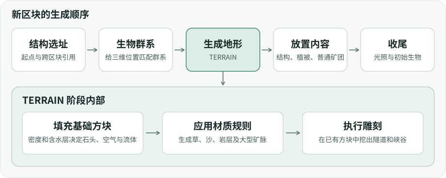
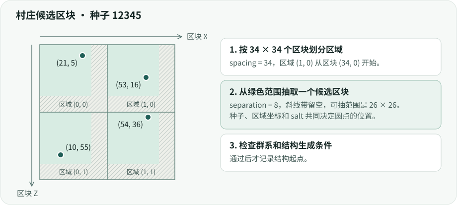
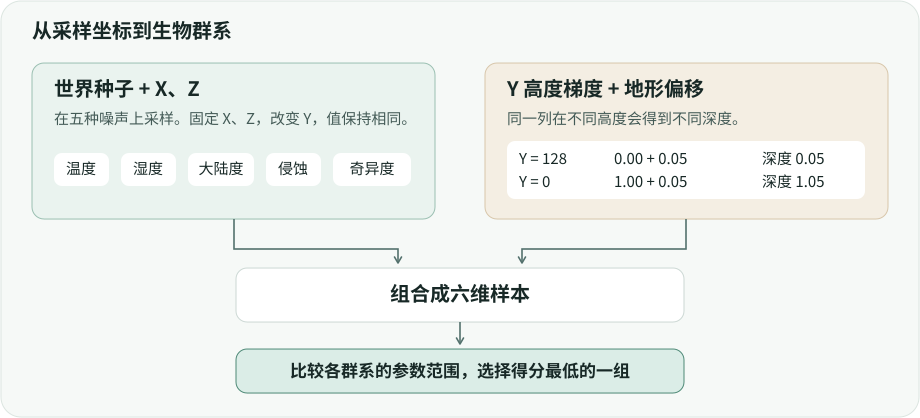
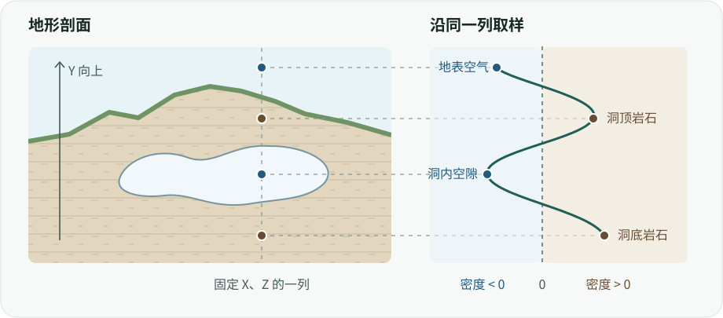
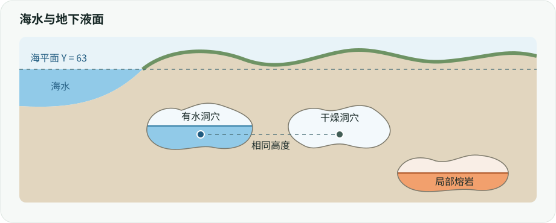

# Minecraft Java 26.3 原版主世界地形生成

## 一眼看懂生成流程

原版用**世界种子、坐标和生成配置**计算每个新区块。区块水平方向是 16 × 16 格。默认主世界从 Y = −64 到 319，海平面参数为 63。世界预设 `minecraft:normal` 给主世界选用噪声生成器，并分别指定生物群系来源和地形设置。 [BetterTerrain 对应版本](../gradle.properties)



拿一块**地表有树、地下有洞穴**的区块来说，种子和坐标先给出一组气候与地形参数。群系匹配确定这里可以出现哪类树，三维密度确定洞穴和岩石在哪里，含水层决定洞里有没有水。地形完成后，放置规则才尝试把树种在地表，把矿团放进岩石。以下剖面和数值算例用来解释机制。

## 1. 结构如何选址

### 从地图区域抽取候选区块

以村庄为例，`structure_set/villages.json` 使用 `random_spread`，配置为 `spacing = 34`、`separation = 8`、`salt = 10387312`。三个参数都来自结构集配置。

1. **划分区域。** 在 X、Z 两个方向分别用区块坐标除以 34，再向下取整，得到区域坐标。例如，区块 X = −1 属于区域 X = −1，区块 X = 34 属于区域 X = 1。
2. **初始化区域的随机序列。** 原版把世界种子、区域 X/Z 和 `salt` 混在一起。随机盐是每个结构集可配置的固定整数，同一世界中的不同结构集可以用它得到不同的候选分布。
3. **抽取区域内的偏移。** 每轴可选偏移是 0 到 25，共有 `34 − 8 = 26` 个位置。村庄用均匀分布在 X、Z 各抽一次，然后把偏移加到区域起点。每个区域靠正 X、正 Z 边界的 8 列或行留给间隔。



图中区域 `(1, 0)` 从区块 `(34, 0)` 开始，种子 `12345` 抽得的偏移是 `(19, 16)`，相加得到候选区块 `(53, 16)`。图上的坐标以区块为单位。复算时，`WorldgenRandom#setLargeFeatureWithSalt` 使用的混合式如下，结果用于原版的旧式随机源。

```text
混合种子 = 世界种子 + 341873128712 × 区域 X + 132897987541 × 区域 Z + salt
候选区块 = 区域坐标 × spacing + 区域内偏移
```

### 从候选区块到实际结构

通过候选筛选后，生成器才尝试生成结构集中的具体变体。村庄集列出平原、沙漠、热带草原、雪原和针叶林村庄，每个变体都有自己的群系条件。例如，平原村庄的群系标签包含平原和草甸。虽然后续才写入区块的群系数据，结构生成器这时就可以直接用群系来源查询生成点。

平原村庄使用拼图结构。它从广场模板池选起始部件，用 `WORLD_SURFACE_WG` 对应的基础地形高度估算广场的位置，再按拼图连接规则尝试拓展道路和房屋。成功后，起点记录结构及其组成部分。跨到其他区块的部分通过结构引用查找，等 `FEATURES` 阶段再实际放置。带地形适配的结构还会通过 `beardifier` 改动附近密度，使地面与结构衔接。 [Mojang 26.3 世界生成说明](https://www.minecraft.net/en-us/article/minecraft-java-edition-26-3)

要塞采用另一种放置方式 `concentric_rings`。它按种子生成一圈圈的候选位置，再在附近查找偏好的群系。原版配置中的 `count = 128` 是总候选数，`spread = 3` 设置第一圈的候选数。由此可以看出，`structure_set` 的放置类型决定了结构在地图上的整体分布。

## 2. 生物群系如何匹配

### 六个参数从哪里来

`noise_settings/overworld.json` 的 `noise_router` 为每个参数指定对应的密度函数。种子和噪声 ID 一起确定可重复的噪声场。游戏把采样坐标传给这些函数，在每个 4 × 4 × 4 格的群系采样单元得到一组参数。

| 参数 | 默认主世界怎样计算 | 参与什么判断 |
| --- | --- | --- |
| 温度 `temperature` | 在温度噪声上进行水平采样。 | 寒冷到炎热的群系范围。 |
| 湿度 `vegetation` | 在独立的湿度噪声上进行水平采样。 | 干燥到湿润的群系范围。 |
| 大陆度 `continents` | 水平采样大陆度噪声。 | 从远洋到海岸和内陆，也参与地形高度的计算。 |
| 侵蚀 `erosion` | 水平采样侵蚀噪声。 | 参与区分不同地势，也用于塑造地形。 |
| 奇异度 `ridges` | 水平采样山脊噪声。 | 区分部分群系变体。程序也用它计算峰谷值。 |
| 深度 `depth` | Y 高度梯度加上该水平位置的地形偏移。 | 帮助区分地表和地下群系，也参与基础地形计算。 |

前五项的默认函数都使用 `y_scale = 0`。它们对 X、Z 做水平缩放与偏移后取样，所以固定 X、Z 时，这五项在各高度相同。深度会随 Y 改变。原版的深度梯度在 Y = −64 取 1.5，在 Y = 320 取 −1.5，两端之间线性过渡。假设这一列的地形偏移是 0.05，Y = 128 的深度就是 `0 + 0.05 = 0.05`，而 Y = 0 时是 `1 + 0.05 = 1.05`。 [Mojang 26.3 噪声与梯度配置说明](https://www.minecraft.net/en-us/article/minecraft-java-edition-26-3)



### 怎样由六个值选出群系

原版预设 `minecraft:overworld` 的参数表由 `OverworldBiomeBuilder` 构造。每条规则对应一个群系和一组六维范围，一个群系可以有多条规则。匹配时，每一维落在规则范围内就记 0，落在范围外就取到最近边界的距离。程序把各维距离的平方相加，并加上这条规则自身的偏置平方，取总分最低的规则。

算例只比较温度和湿度，其余参数和规则偏置的贡献假设相同。采样温度为 0.30，湿度为 0.55。

| 规则 | 温度范围 → 距离 | 湿度范围 → 距离 | 两项的距离平方和 |
| --- | --- | --- | --- |
| A | 0.10 到 0.40 → 0 | 0.20 到 0.40 → 0.15 | 0.0225 |
| B | 0.50 到 0.70 → 0.20 | 0.50 到 0.60 → 0 | 0.0400 |

这里会选 A，因为它在这两维的总分更低。实际生成时深度也一起参与比较，于是同一组 X、Z 上，较高处可以匹配森林，较低处可以匹配繁茂洞穴。

## 3. 三维密度如何形成山脉和洞穴

**噪声**是随坐标连续变化的伪随机数值。可以想象两张起伏的图，大尺度噪声让大片区域一起抬升或下沉，小尺度噪声则在上面叠出局部起伏。原版先从大陆度、侵蚀和山脊等输入推出地形的高度偏移、坡度和尖峭程度，再结合高度梯度与三维噪声，得到基础地形。中间用**样条曲线**在预设的控制点之间平滑过渡。例如，大陆度逐渐进入内陆的范围时，高度偏移可以逐渐变化。

噪声的空间尺度和各层权重可以分别调整。`xz_scale` 越小，相隔同样距离的两个位置通常采到更接近的值，因此变化铺得更开。`worldgen/noise` 下的 `base_octave` 和 `octave_count` 定义叠加的尺度，`amplitude_modifiers` 决定各层的贡献。大陆度既输入群系匹配，也影响基础地形，所以调整它的尺度可能同时改变海岸轮廓和沿岸群系的分布。 [Mojang 26.3 噪声配置说明](https://www.minecraft.net/en-us/article/minecraft-java-edition-26-3)

基础地形还会和洞穴函数、结构周围的密度调整结合，得到 `final_density(x, y, z)`。在填充阶段，密度大于 0 的位置先放基础实体方块，默认是石头。其余位置交给含水层等逻辑处理。图中沿固定 X、Z 向下观察，四个采样点依次经过地表空气、洞顶、洞内空隙和洞底。密度多次越过 0，洞穴就能夹在两层岩石之间。



逐格计算整套函数会耗费更多时间。原版的最终密度里有一支用 **4 × 8 × 4** 格的网格插值。先算网格角点，再根据格内位置在三个方向上混合角点的值。最终结果还会合并面条洞穴与结构的密度调整。 [Mojang 26.3 噪声与密度函数说明](https://www.minecraft.net/en-us/article/minecraft-java-edition-26-3)

## 4. 海平面以下为什么也会有干燥洞穴

海平面提供主世界的默认水位。地下的 `aquifers`（含水层）在此基础上为不同区域计算**局部液面**和流体类型。处理一个空隙时，生成器会查看附近的含水层采样点。局部液面高于这个位置时可以填入水或熔岩，液面较低或局部含水层干燥时可以留下空气。不同含水层交界处也可能保留实体方块作为隔层。



26.3 的 `aquifers` 配置为这些判定分别提供函数。例如，`fluid_level_floodedness` 影响某片区域是否易于充水，`fluid_level_spread` 影响局部液面的起伏，`barrier` 影响液体交界处的分隔。 [Mojang 含水层介绍](https://feedback.minecraft.net/hc/en-us/articles/4415128577293-Minecraft-Java-Edition-1-18) · [Mojang 26.3 含水层配置说明](https://www.minecraft.net/en-us/article/minecraft-java-edition-26-3)

## 5. 草地、沙层和大型矿脉从哪里来

基础填充完成后，`material_rule` 为地形选材。规则会检查群系、距岩层表面的深度、水位等条件，按顺序寻找能返回方块的规则。例如，一片露出水面的平原可以覆盖草方块，下一层是泥土。切换到沙漠群系后，符合条件的表层可以铺沙，下面可以出现砂岩。

大型铜、铁矿脉也在这一阶段产生。`minecraft:ore_vein` 规则可以用密度函数决定哪些位置有机会进入矿脉，再按矿石出现的概率和粗矿块概率选择方块。矿脉中还会混入伴生岩石，所以沿着矿脉挖掘时，会看到矿石、粗矿块和岩石交错出现。 [Mojang 26.3 材质与矿脉说明](https://www.minecraft.net/en-us/article/minecraft-java-edition-26-3)

## 6. 两种洞穴算法如何配合

**噪声洞穴在填充前形成。** 洞穴函数通过密度运算留下空隙。用简化的 `min(地形密度, 洞穴密度)` 举例，某处原本是 `0.8`，洞穴函数给出 `−0.3`，取较小值后这里就交给含水层逻辑。原版组合了多种形状，奶酪洞穴常形成宽阔洞厅，意大利面洞穴形成蜿蜒通道，面条洞穴提供更细的隧道。

**雕刻洞穴在材质应用后形成。** `carver` 按种子和配置选择起始区块，再逐步改变方向、半径和高度，沿路径标记要挖掉的位置。一条路径可以跨过区块边界。生成器按这些标记修改已有方块，并由含水层或海平面设置决定挖开后是否填入液体。两种洞穴可以贯通，碰到地面时会形成洞口。 [Mojang 噪声洞穴说明](https://feedback.minecraft.net/hc/en-us/articles/4415128577293-Minecraft-Java-Edition-1-18) · [Mojang 26.3 雕刻器说明](https://www.minecraft.net/en-us/article/minecraft-java-edition-26-3)

## 7. 地形完成后怎样放树和普通矿团

群系列出要尝试的 `placed_feature`。放置器挑候选位置，`feature` 则在候选位置执行具体的生成算法。

| 内容 | 怎样选位置 | 放置时检查什么 |
| --- | --- | --- |
| 树 | 选一个 X、Z，查高度图找地表。高度图记录每列符合条件的最高方块参考高度。 | 树能否在该处扎根，树干和树冠有没有足够空间。 |
| 普通矿团 | 选 X、Z，再按配置的高度分布抽取 Y。 | 候选位置周围哪些方块符合替换规则。 |

原版的 `ore_diamond` 是一项钻石矿团放置配置。它的尝试次数为 7，依次进行水平散布、高度抽样和群系筛选。每次成功放置的矿石数量取决于周围岩石及替换条件。 [Fabric 26.3 特征生成文档](https://docs.fabricmc.net/develop/data-generation/features)

## 8. 相邻区块怎样接起来

地形噪声按世界坐标采样。假如区块边界在 X = 16，两侧的 X = 15 和 X = 16 本来就是相邻的采样位置，因此同一套设置生成的山和谷可以自然跨过边界。结构和雕刻还会考虑相关的相邻区块，分别写入落在各自区块内的部分。

旧世界升级是另一种情况。已经生成的区块保存了旧地形，新区块使用当前算法。原版的 `blend_density` 可以读取旧区块附近的混合数据，在过渡带内调整新区块的密度，让新地形接向旧地形。 [Mojang 旧区块过渡说明](https://feedback.minecraft.net/hc/en-us/articles/4415128577293-Minecraft-Java-Edition-1-18)

## 按效果查找原版配置

原版 JAR 中的这些文件都位于 `data/minecraft/worldgen/` 下。路径用 26.3 的命名。

| 想了解的效果 | 从哪里查 |
| --- | --- |
| 主世界绑定了哪个生成器、群系来源和噪声设置 | `world_preset/normal.json` |
| 海平面、含水层、密度函数入口 | `noise_settings/overworld.json` |
| 六个群系参数从哪里采样 | `noise_settings/overworld.json` 的 `noise_router`，以及 `density_function/overworld/` 和 `noise/` 中的引用 |
| 默认群系范围表 | `multi_noise_biome_source_parameter_list/overworld.json` 指向内置预设，具体规则由 `OverworldBiomeBuilder` 构造 |
| 山脉、低谷和噪声洞穴的形状 | `density_function/overworld/final_density.json` 及其引用 |
| 草地、岩层和大型铜、铁矿脉 | `material_rule/overworld.json` 及其引用 |
| 雕刻隧道的数量和粗细 | `carver/cave.json` |
| 村庄的候选间距、要塞的环形参数 | `structure_set/villages.json`、`structure_set/strongholds.json` |
| 平原村庄的群系限制、广场模板与地形适配 | `structure/village_plains.json` |
| 钻石矿团的放置次数 | `placed_feature/ore_diamond.json` |
